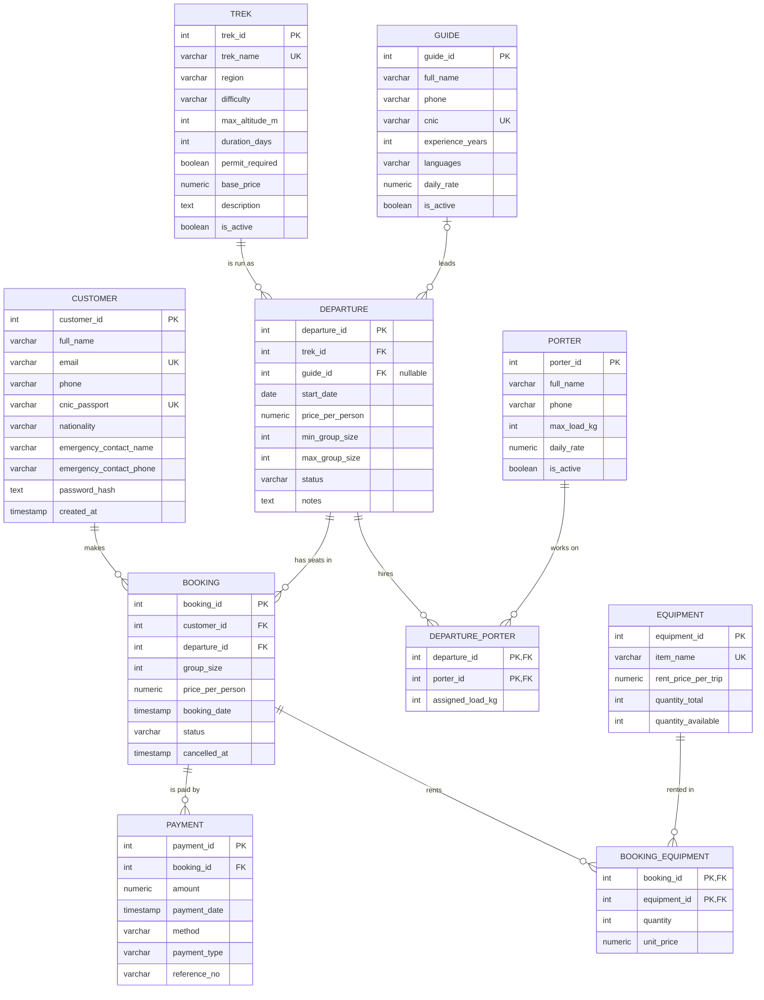

# ER Model — Trekking & Expedition Management

Crow's Foot notation (Mermaid renders this on GitHub). Draft for Milestone 1:
**update it after the operator interview.**

## Relationships (cardinality and participation)

| Relationship | Cardinality | Participation |
|---|---|---|
| Customer **makes** Booking | 1 : N | Booking total (every booking has a customer); Customer partial (may have no bookings) |
| Trek **is run as** Departure | 1 : N | Departure total; Trek partial (a new trek may have no dates yet) |
| Guide **leads** Departure | 1 : N | Both partial (a departure can be created before a guide is chosen) |
| Departure **has seats in** Booking | 1 : N | Booking total; Departure partial |
| Departure **hires** Porter | M : N (via DEPARTURE_PORTER, attribute `assigned_load_kg`) | Both partial |
| Booking **is paid by** Payment | 1 : N | Payment total; Booking partial (pending bookings have no payment) |
| Booking **rents** Equipment | M : N (via BOOKING_EQUIPMENT, attributes `quantity`, `unit_price`) | Both partial |

## Design decisions worth explaining in the report

- **Trek vs Departure.** A trek is the route; a departure is one dated group on it. Without this split, trek details (altitude, region) would repeat for every date — a normalization problem.
- **End date is not stored.** It is `start_date + duration_days - 1`, so storing it would be a derived value that can go out of sync (e.g. when a trek's length changes). It is computed in `fn_departure_end_date` and the views.
- **Price is copied into Booking and BOOKING_EQUIPMENT.** Not redundancy: it records the price the customer agreed to *at that time*. Later price changes must not change old bookings.
- **Totals and amount paid are not stored.** They are computed from booking lines and payments (`fn_booking_total`, `fn_booking_paid`), so they can never disagree with the payment history.
- **`quantity_available` is stored** (a deliberate exception) so stock checks are fast and can be locked with `SELECT ... FOR UPDATE`. Triggers keep it consistent; the CHECK constraint `0 <= available <= total` guards it.

## Normalization to 3NF (summary)

- **1NF:** every column holds one value; no repeating groups. Porters per departure and gear per booking are separate rows in bridge tables, not lists in a column.
- **2NF:** the only composite keys are the two bridge tables. `assigned_load_kg` depends on the full key (departure + porter); `quantity` and `unit_price` depend on the full key (booking + equipment). No partial dependencies.
- **3NF:** no non-key column depends on another non-key column. Trek facts live only in TREK, guide facts only in GUIDE, customer facts only in CUSTOMER. Derived values (end date, totals, balance, seats left) are calculated, not stored.
- Known trade-off: `region` is a text column in TREK. If regions later get their own attributes (permit office, district), split it into a REGION table.
