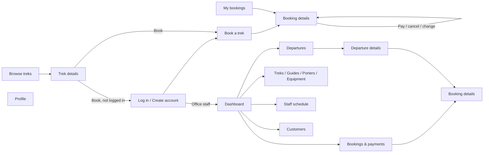

# Screens, Navigation and SQL Queries

For report sections 6 and 7. Query numbers (Q1, Q2...) match the comments
in `backend/src/routes/*.js`, where the full SQL for each one lives.
Copy the SQL from there into the report, or take screenshots of it.

## User flow

## Customer screens

| Screen | Purpose and actions | Navigation | Queries | CRUD |
|---|---|---|---|---|
| Browse treks `/` | List treks; filter by region, difficulty, text | Start page; click a row → Trek details | Q1 (treks + next date + lowest price, uses `v_departure_overview`), Q2 (regions) | R |
| Trek details `/treks/:id` | Trek facts, open dates, seats left; Book button | From Browse; Book → Book a trek (or Login first) | Q3, Q4 | R |
| Log in / Create account `/login` | Customer login, registration, office staff login | Top bar; redirected when booking while logged out | Q6 `fn_register_customer`, Q7 `fn_customer_login` | C, R |
| Book a trek `/book/:departureId` | Choose people and gear, see total, book | From Trek details → Booking details | Q4b, Q5, Q15 `CALL sp_create_booking` | C |
| My bookings `/my/bookings` | All bookings with paid and balance | Top bar; row → Booking details | Q11 (`v_booking_summary`) | R |
| Booking details `/my/bookings/:id` | Pay advance/balance, change people, cancel, delete unpaid | From My bookings or after booking | Q12–Q14, Q16 UPDATE, Q17 `sp_record_payment`, Q18 `sp_cancel_booking`, Q19 DELETE | R, U, C, D |
| Profile `/my/profile` | Edit details, change password | Top bar | Q8, Q9, Q10 | R, U |

## Office (admin) screens

| Screen | Purpose and actions | Navigation | Queries | CRUD |
|---|---|---|---|---|
| Dashboard `/admin` | Key numbers, warnings, next 30 days, latest payments, revenue per trek | After admin login; sidebar | Q20–Q23 (`v_departure_overview`, `v_trek_performance`, `v_booking_summary`) | R |
| Departures `/admin/departures` | List with status filter; add departure | Sidebar; row → Departure details | Q28, Q34 INSERT | R, C |
| Departure details `/admin/departures/:id` | Edit, assign guide, add/remove porters, delay, cancel, complete, delete | From Departures, Dashboard, Schedule | Q29–Q33, Q35 UPDATE, Q36 DELETE, Q37 `sp_assign_guide`, Q38 `sp_assign_porter`, Q39 DELETE porter, Q40 `sp_delay_departure`, Q41 `sp_cancel_departure`, Q42 `sp_complete_departure` | R, U, C, D |
| Bookings & payments `/admin/bookings` | All bookings, search and status filter | Sidebar; row → Booking details | Q56 | R |
| Booking details (admin) `/admin/bookings/:id` | Record office payment, cancel | From Bookings, Departure details, Dashboard | Q57, Q58 `sp_record_payment`, Q59 `sp_cancel_booking` | R, C, U |
| Treks `/admin/treks` | Add, edit, deactivate, delete | Sidebar | Q24–Q27 | C, R, U, D |
| Guides `/admin/guides` | Add, edit, deactivate, delete | Sidebar | Q43–Q46 | C, R, U, D |
| Porters `/admin/porters` | Add, edit, deactivate, delete | Sidebar | Q47–Q50 | C, R, U, D |
| Equipment `/admin/equipment` | Add, edit stock and price, delete | Sidebar | Q52–Q55 | C, R, U, D |
| Staff schedule `/admin/schedule` | Who works on which trek | Sidebar; trek link → Departure details | Q51 (`v_staff_schedule`) | R |
| Customers `/admin/customers` | List with bookings and amount paid; delete | Sidebar | Q60, Q61 | R, D |

## How the app connects to PostgreSQL

- **Frontend:** React (Vite). It never talks to the database directly; it calls the API with `fetch('/api/...')`.
- **Backend:** Node.js + Express. It uses the `pg` library with a connection **Pool** (`backend/src/db.js`), configured from the `.env` file (host, port, database, user, password).
- **Parameterized queries:** every query uses `$1, $2 ...` placeholders, so user input is never pasted into SQL (protects against SQL injection).
- **Procedures** are run with `CALL sp_name($1, ...)`; `INOUT` parameters (new booking id, refund amount) come back as a result row.
- **Errors:** when a trigger blocks something it uses `RAISE EXCEPTION` (code `P0001`). The API sends that message to the screen, so the user sees e.g. "Not enough seats: 1 left on this departure, 2 requested".
